# Manifest

Five systems, one warehouse stack. This repository is the architecture that
connects them, the walk of one order through all of them, and the map of the
real-world interfaces each layer would meet in a real building.

| Layer | System | One line |
|---|---|---|
| Integration | [`switchyard`](https://github.com/SukrutN/switchyard) | a Go broker with durable journaled lanes; one binary, one wire protocol, one file of documentation |
| Slotting | [`quay`](https://github.com/SukrutN/quay) | where every carton should stand: the kinship-reach score, anchors in the golden band, one deterministic pass |
| Picking & labor | [`northspan`](https://github.com/SukrutN/northspan) | the picker's route and the standard that prices it, against the sweep and in minutes |
| Fleet | [`hearthlane`](https://github.com/SukrutN/hearthlane) | CBS and ICBS over a painted floor: joint plans, deadlines, congestion, a release gate |
| The line | [`fluxline`](https://github.com/SukrutN/fluxline) | an IEC 61131-3 sortation program, its twin, and the supervisory host that can only request |

## The stack, one page

```mermaid
flowchart LR
    order["An order lands"] --> lane["switchyard lane: orders.*"]
    lane --> quay["quay: seat the cartons"]
    quay --> lanes["slotting.* on the lane"]
    lanes --> fork{"who picks it up"}
    fork -->|"a person"| northspan["northspan: the walk and the standard"]
    fork -->|"a robot"| hearthlane["hearthlane: the joint plan"]
    northspan --> linehost["switchyard linehost"]
    hearthlane --> linehost
    linehost -->|"Modbus: a request, never a command"| fluxline["fluxline: the line decides"]
    fluxline -->|"verdicts journaled before the ack"| verdicts["verdicts.* on the lane"]
    verdicts --> ledger["the day's ledger, closed"]
```

## The seams

Three rules hold the stack together, and each one is proven inside a repo,
not asserted here.

1. **The host can only request.** fluxline's host command block carries
   release requests to the line's Modbus surface, and the routing law keeps
   the last word: the [veto
   walkthrough](https://github.com/SukrutN/fluxline) shows a tall item
   asked to L01 and taken to L03 anyway. The floor decides; everything
   above it proposes.

2. **At-least-once, with the sweeper recognized.** switchyard's
   [linehost](https://github.com/SukrutN/switchyard) journals every
   verdict before the lane ack, so a crash replays the work instead of
   losing the receipt; a redelivery is recognized, not re-run. Nothing in
   the chain invents or loses a box.

3. **Figures are locked, not copied.** Every repo carries a
   characterization contract: the engine prints its reading, a golden copy
   stores it, and the site's tests must replay it figure for figure. A
   change on either side that moves a number fails the build. The five
   sites render nothing they did not derive.

## The walkthrough

[One order's day](docs/orders-day.md) — the exact lanes, subjects,
messages, and the real entrypoint of each system, from the order's arrival
to the closed ledger. The harness runs it: `harness/run-day.ps1` drives
the five against one order and replays the ledger; exit 0 means every
claim was on its lane and every figure held.

## The real world

[The interfaces each layer meets](docs/integrations.md) — OPC UA,
MQTT with Sparkplug B, X12 940 / 945 / 856, and GS1-128: what each one is,
when it is the right tool, and where it lands in this stack.

## License

MIT — see [LICENSE](LICENSE).
