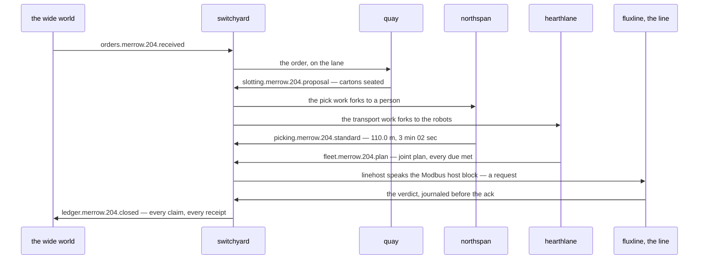

# One order's day

A single order — ticket MR-204, the Merrow Chandlery restock — walks the
whole stack: it lands on a lane, gets its cartons seated, forks between a
person's walk and a robot's plan, rides the sorting line, and closes the
day in the ledger. Every hop below is a real interface in a real
repository; the numbers are each system's own locked figures.

## The cast

| System | Its job today | Its real entrypoint |
|---|---|---|
| switchyard | carries the order between everyone | `spur stream push orders <payload>` on the durable lane |
| quay | seats the cartons on the face | `quay putaway <day> --json`, or the workbench at `:8091` |
| northspan | prices the person's walk | the `/your-floor` planner; `dotnet test engine` locks the same figures |
| hearthlane | plans the robots' joint paths | `hearth plan <fixture>`, `hearth windows` |
| fluxline | sorts the carton, and keeps the last word | the IEC 61131-3 program; switchyard's `linehost -lane fluxline` speaks its Modbus host block |

## The day



## The messages, hop by hop

Subjects follow [switchyard's
charter](https://github.com/SukrutN/switchyard): dot-separated tokens, `*`
matching one token, `>` trailing everything. Subscribers hold patterns;
publishers hold facts.

**1. The order lands.**

```json
{ "id": "MR-204", "house": "Merrow Chandlery",
  "lines": [{ "faceId": "CIN-01-W", "qty": 2 }, { "faceId": "REE-02-E", "qty": 1 }] }
```

Subject `orders.merrow.204.received`. A subscriber pattern of
`orders.*.received` sees every order that ever lands. The lane is durable:
a pushed row is not acknowledged until its bytes are on disk.

**2. The cartons get seated.** quay reads the order's velocity, weight,
and cube, and answers with a placement proposal: anchors in the golden
band, heavy goods low, co-picked goods together. On its demo face the
same score turns a day of pick walking from 126 km into 37 km — the
reading its `ScaleTest` re-proves every CI run.

Subject `slotting.merrow.204.proposal`.

**3. The pick forks.** A carton is either a person's walk or a robot's
ride, and the two planners answer on their own subjects.

The person's walk, by northspan — the locked reading for MR-204:

```json
{ "ticketId": "MR-204", "stops": 5, "lines": 5, "units": 10,
  "distanceM": 110.0, "sweepDistanceM": 150.8,
  "totalSeconds": 181.652, "standard": "3 min 02 sec",
  "buckets": ["travel 95.652", "grab/line 15", "grab/unit 20",
              "count/give 15", "maneuver 20", "put/verify 10", "pack split 6"] }
```

The route is nearest-neighbour seeded, improved by two-opt, and priced
against the serpentine sweep — 110.0 m against 150.8 m, the comparison
[Petersen (1997)](https://github.com/SukrutN/northspan) drew.

The robots' plan, by hearthlane — its casting-hall run, every due met:

```json
{ "batch": "MR-204", "planner": "icbs",
  "cost": 69, "gap": 0,
  "arrivals": { "AMR-3": { "due": 9, "landed": 5, "spare": 4 } },
  "scaleProof": "64x64 floor, 100 robots, ~67 ms, repeat agrees path for path" }
```

Subject `fleet.merrow.204.plan`, granted through the release gate: urgent
work first, congestion visible before the wave goes out.

**4. The carton rides the line.** switchyard's linehost consumes the
release work from its lane and speaks the fluxline host command block over
Modbus TCP — a request, never a command:

```json
{ "id": "box-42", "gate": 2, "class": 0 }
```

One release in flight at a time; the heartbeat rides inside the command
frame so the watchdog is never starved. The line answers with the only
verdict that matters, journaled before the lane ack:

```json
{ "id": "box-43", "seq": 2, "state": "vetoed", "gate": 3,
  "class": 3, "latency_ms": 21430 }
```

A `vetoed` state is the stack working as designed: the host asked for
gate 2, the floor measured the piece, and the routing law took it to
L03 anyway. The floor keeps the last word.

**5. The ledger closes.** Every claim and every receipt of the day sits
on the lanes: the order that arrived, the seats that were proposed, the
walk that was priced, the plan that was released, the verdicts that came
back. A durable consumer replays exactly the rows the last session never
acknowledged — no invention, no loss.

Subject `ledger.merrow.204.closed`.

## What runs today

| Hop | Interface | State |
|---|---|---|
| The order lands | switchyard lane + charter | runs today — `go run ./cmd/switchyard`, `spur` |
| Cartons seated | `quay putaway --json` / workbench `:8091` | runs today |
| The person's walk | northspan's planner + standards, locked by its tests | runs today |
| The robots' plan | `hearth plan` / `hearth windows` | runs today |
| The carton rides | `linehost -lane fluxline` → the line's Modbus host block | runs today |
| **The whole day, end to end** | one harness driving the five against one order | **designed here — the next increment** |

The last row is the honest one: each hop is a real system's real
interface, proven by that repo's own tests. What does not exist yet is
the harness that runs all five in sequence against a single order and
replays the ledger. The subjects and payloads above are its contract.
